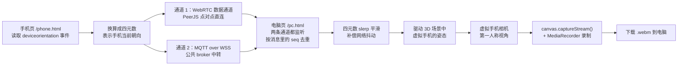

# 手机陀螺仪遥控 3D 虚拟手机

用你手上真手机的陀螺仪，去操控电脑上一个 Three.js 3D 场景里的「虚拟手机」：转动真手机，场景里那台虚拟手机的摄像头就跟着左/右/上/下看（第一人称视角）。按下录制键后，录制的是「虚拟手机摄像头第一人称视角」的画面，导出成 `.webm` 文件下载到电脑。

整个项目是一个**纯静态网站**，没有构建步骤，直接把文件部署到 GitHub Pages 就能用。

---

## 它是怎么工作的

电脑页面（`pc.html`）和手机页面（`phone.html`）之间只传「手机朝向」这一件事，其余（3D 场景、录制）都在电脑端完成。



几点说明：

- **双通道并发 + 按序号去重**：手机端把自己的设备朝向，**同时**用 WebRTC（PeerJS 数据通道，点对点）和 MQTT over WSS（公共 broker 中转）发出去。电脑端两条通道都监听，按消息里的自增 `seq` 去重，谁先到就用谁。这样做的好处是不需要双方协商走哪条路，只要任意一条通就可用，两条自动互为备份。
- **配对方式**：电脑端生成一个 4 位数字房间号并显示二维码；手机端扫二维码或手动输入房间号即可连接。
- **平滑**：电脑端收到朝向后，用四元数 + 球面线性插值（slerp）做平滑，抵消网络抖动带来的卡顿。

---

## 快速开始

### 在线用法（推荐）

1. 电脑浏览器打开 `<你的站点地址>/pc.html`。页面会显示一个 **4 位数字房间号**和一张二维码。
2. 手机浏览器打开**同一个站点**的 `/phone.html`。
3. 用手机扫电脑上的二维码，或者手动输入那 4 位房间号，完成连接。
4. 在手机上点「启用陀螺仪」。
   - iOS 上**必须**点这个按钮（出于隐私，系统要求用户手势才能授权），而且页面必须是 HTTPS。
5. 电脑上按「开始录制」即可。录制结束后会下载一个 `.webm` 文件。

> 用 GitHub Pages 部署时地址形如 `https://YOUR_USERNAME.github.io/YOUR_REPO/pc.html`。GitHub Pages 自带 HTTPS，这正是手机能拿到陀螺仪权限的前提。

### 本地测试

在项目根目录执行：

```bash
python tools/serve.py
```

终端会打印本机地址和局域网地址，例如 `http://localhost:8000/` 和 `http://192.168.1.5:8000/`。然后：

- 电脑打开 `http://localhost:8000/pc.html`；
- 手机（连同一个 Wi-Fi）打开打印出来的局域网地址下的 `/phone.html`。

注意：这条命令走的是普通 HTTP。**HTTP 下手机浏览器不给陀螺仪权限**，所以本地测试时手机端只能用**触摸方向键**这种备用操作方式；电脑端页面可以做正常的 3D 场景与录制调试。想要真正用陀螺仪，请按下面一节部署到 GitHub Pages。

---

## 部署到 GitHub Pages

### 方式 a：用 GitHub 网页界面

1. 在 GitHub 上新建一个仓库（比如叫 `virtual-phone`），公开或私有都可以。
2. 把本地代码上传/推送到这个仓库。
3. 打开仓库的 **Settings → Pages**。
4. 在 **Source** 里选择 **GitHub Actions**。
5. 等待仓库的 **Actions** 页面里那次部署跑完，站点就会发布在 `https://YOUR_USERNAME.github.io/YOUR_REPO/`。

之后每次向 `main` 分支推送代码，都会自动重新部署（流水线在 `.github/workflows/pages.yml`）。也可以在 Actions 页面手动触发（`workflow_dispatch`）。

### 方式 b：用命令行

在项目根目录依次执行（把 `YOUR_USERNAME`、`YOUR_REPO` 换成你自己的）：

```bash
git init
git add .
git commit -m "首次提交：手机陀螺仪遥控 3D 虚拟手机"
git branch -M main
git remote add origin https://github.com/YOUR_USERNAME/YOUR_REPO.git
git push -u origin main
```

推送完成后，再按方式 a 的第 3~5 步，在 Settings → Pages 里把 Source 选成 **GitHub Actions**，等 Actions 跑完即可。

---

## 常见问题

**iOS 上陀螺仪没反应？**
两个前提要同时满足：页面必须是 **HTTPS**（GitHub Pages 自带，所以用 Pages 就没问题），并且要由**用户手势**去触发 `DeviceOrientationEvent.requestPermission()`。页面右上有「启用陀螺仪」按钮，先点一次它。另外请在 iOS 的「设置 → Safari → 动作与方向访问」里把开关打开。

**手机和电脑连不上？**
本项目是双通道设计，WebRTC 和 MQTT 任意一条通就能用。可以这样排查：确认手机是联网状态；公共 MQTT broker 偶尔不稳定，等一会儿它会自动重连；再确认两边的**房间号完全一致**（4 位数字）。

**只有 2 个数字的房间号输不进去？**
房间号固定是 4 位数字，请完整输入 4 位。

**录出来的视频打不开，或者后缀是 `.webm`？**
`.webm` 用 Chrome / Edge 就能播放。如果要用其他软件或设备播放，可以用 ffmpeg 转成 mp4：

```bash
ffmpeg -i in.webm -c:v libx264 -pix_fmt yuv420p out.mp4
```

**录出来是横屏，但我想竖屏；或者视频不清楚？**
在电脑端的控制面板里可以调整分辨率和画质（就在 `pc.html` 页面的面板上）。

**手机上能同时用陀螺仪和触摸拖拽吗？**
可以。在陀螺仪模式下手动拖拽会作为一个「偏移量」叠加在陀螺仪姿态之上，方便你做细微微调。

---

## 目录结构

| 路径 | 说明 |
| --- | --- |
| `index.html` | 入口页，选择角色：「我是电脑」或「我是手机」。 |
| `pc.html` | 电脑端页面：3D 视口、虚拟手机、连接面板与录制按钮。 |
| `phone.html` | 手机端页面：读取陀螺仪并发送朝向的遥控器。 |
| `src/` | 页面用到的 JavaScript 源码（Three.js 场景、连接、录制等）。 |
| `vendor/` | 内嵌的第三方库：`three.module.js`、`OrbitControls.js`、`peerjs.min.js`、`mqtt.min.js`。 |
| `assets/css/style.css` | 页面样式表。 |
| `tools/serve.py` | 本地静态测试服务器，供局域网联调使用。 |
| `.github/workflows/pages.yml` | GitHub Actions 部署到 GitHub Pages 的流水线。 |

---

## 技术栈与限制

- **依赖已内嵌在本仓库**：`three.module.js`、`OrbitControls.js`、`peerjs.min.js`、`mqtt.min.js` 都放在 `vendor/` 里，运行时不再从 CDN 拉取，国内访问更稳、也不会因为 CDN 抽风而白屏。
- **无构建步骤**：没有打包、编译、npm 安装这些环节，改完文件直接刷新即可，部署也只需要原样上传。
- **浏览器要求**：需要支持 WebRTC 和 ES Modules 的现代浏览器（较新的 Chrome / Edge / Safari / Firefox）。一些老旧的国产内核浏览器可能不支持 ES Modules。
- **iOS 需要 HTTPS**：iOS 只在 HTTPS 页面下才允许读取陀螺仪，并且必须由用户手势触发授权按钮。请使用 GitHub Pages 提供的 HTTPS 地址访问。