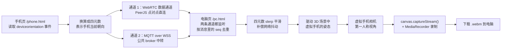

# 手机陀螺仪遥控 3D 虚拟手机

用你手上真手机的陀螺仪，去操控电脑上一个 Three.js 3D 场景里的「虚拟手机」：转动真手机，场景里那台虚拟手机的摄像头就跟着左/右/上/下看（第一人称视角），**手机转多少度，虚拟手机就转多少度（严格 1:1）**。电脑端还能用 **WASD** 带着这台虚拟手机在场景里前后左右走动，像一个真人一样边转视角边走路。按下录制键后，录制的是「虚拟手机摄像头第一人称视角」的画面，导出成 `.webm` 文件下载到电脑。

整个项目是一个**纯静态网站**，没有构建步骤，直接把文件部署到 GitHub Pages 就能用。

已经在线的站点：

| | 地址 |
|---|---|
| 入口 | <https://chenbaitang388-dot.github.io/virtual-phone-camera/> |
| 电脑端 | <https://chenbaitang388-dot.github.io/virtual-phone-camera/pc.html> |
| 手机端 | <https://chenbaitang388-dot.github.io/virtual-phone-camera/phone.html> |

手机端**必须**从这个 HTTPS 地址打开，因为浏览器只在 HTTPS 页面里才允许读取陀螺仪。

---

## 它是怎么工作的

电脑页面（`pc.html`）和手机页面（`phone.html`）之间只传「手机朝向」这一件事，其余（3D 场景、录制）都在电脑端完成。



几点说明：

- **双通道并发 + 按序号去重**：手机端把自己的设备朝向，**同时**用 WebRTC（PeerJS 数据通道，点对点）和 MQTT over WSS（公共 broker 中转）发出去。电脑端两条通道都监听，按消息里的自增 `seq` 去重，谁先到就用谁。这样做的好处是不需要双方协商走哪条路，只要任意一条通就可用，两条自动互为备份。
- **配对方式**：电脑端生成一个 6 位房间码并显示二维码；手机端扫二维码或手动输入房间码即可连接。房间码用的是 31 个不容易看错的字符（去掉了 `0 o 1 l i`）取 6 位，约 8.9 亿种组合。
- **平滑**：电脑端收到朝向后，用四元数 + 球面线性插值（slerp）做平滑，抵消网络抖动带来的卡顿。

---

## 快速开始

### 在线用法（推荐）

1. 电脑浏览器打开 `<你的站点地址>/pc.html`。页面会显示一个 **6 位房间码**和一张二维码。
2. 手机浏览器打开**同一个站点**的 `/phone.html`。
3. 用手机扫电脑上的二维码，或者手动输入那 6 位房间码，完成连接。
4. 在手机上点「启用陀螺仪」。
   - iOS 上**必须**点这个按钮（出于隐私，系统要求用户手势才能授权），而且页面必须是 HTTPS。
5. 拿着手机朝向你想当作「正前方」的方向，点手机上的「设正」（或电脑端按 `C`），三个读数会归零。
6. 电脑上按「开始录制」即可。录制时可以用 `WASD` 在场景里走动。录制结束后会下载一个 `.webm` 文件。

> 用 GitHub Pages 部署时地址形如 `https://YOUR_USERNAME.github.io/YOUR_REPO/pc.html`。GitHub Pages 自带 HTTPS，这正是手机能拿到陀螺仪权限的前提。

## 手感：1:1、设正、校平、走动

**灵敏度固定 1:1。** 手机转 30°，虚拟手机就转 30°，不做任何放大或缩小。
「平滑」滑杆只影响跟手速度，不影响最终角度——停下来之后角度与真机完全一致。

| 操作 | 电脑端 | 手机端 | 作用 |
| --- | --- | --- | --- |
| 设正 | 「设正」按钮 / 快捷键 `C` | 「设正」按钮、方向盘中间 | 把手机当前朝向记成“正前方”，左右/俯仰/翻滚读数全部归零 |
| 校平 | 「校平」按钮 / 快捷键 `V` | 「校平」按钮 | 只把地平线转正，看的方向和俯仰不变，画面不跳 |
| 自动校平 | 开关，默认开 | 跟随电脑端 | 地平线始终水平；关掉后手机怎么翻滚，虚拟手机就怎么翻滚（完整 3DoF） |

**横屏 / 竖屏**：手机端会显示当前屏幕方向，姿态换算按 `screen.orientation.angle` 分别处理，
所以手机横过来时画面不会跟着翻滚 90°，而是像相机 App 一样保持地平线水平。
手机页在横屏时会自动切成左右两栏（左边陀螺仪，右边方向盘）。

**走动**（电脑端键盘）：

- `W` / `S` 前进 / 后退，`A` / `D` 左右平移，方向永远跟着当前视线走；
- `Shift` 加速，`R` 回到场景原点；
- 有加减速、场地边界和柱子碰撞，导播视角会自动跟着虚拟手机；
- 走位会直接出现在录制画面里。

第一次连上时，电脑会自动把收到的第一帧姿态当作“正前方”。想精确对正，拿着手机朝向目标方向按一下「设正」即可。

### 本地测试

在项目根目录执行：

```bash
python tools/serve.py
```

终端会打印本机地址和局域网地址，例如 `http://localhost:8000/` 和 `http://192.168.1.5:8000/`。然后：

- 电脑打开 `http://localhost:8000/pc.html`；
- 手机（连同一个 Wi-Fi）打开打印出来的局域网地址下的 `/phone.html`。

注意：这条命令走的是普通 HTTP。**HTTP 下手机浏览器不给陀螺仪权限**，所以本地测试时手机端只能用**触摸方向键**这种备用操作方式；电脑端页面可以做正常的 3D 场景与录制调试。想要真正用陀螺仪，请按下面一节部署到 GitHub Pages。

---

## 部署到 GitHub Pages

### 方式 a：用 GitHub 网页界面

1. 在 GitHub 上新建一个仓库（比如叫 `virtual-phone`），公开或私有都可以。
2. 把本地代码上传/推送到这个仓库。
3. 打开仓库的 **Settings → Pages**。
4. 在 **Source** 里选择 **GitHub Actions**。
5. 等待仓库的 **Actions** 页面里那次部署跑完，站点就会发布在 `https://YOUR_USERNAME.github.io/YOUR_REPO/`。

之后每次向 `main` 分支推送代码，都会自动重新部署（流水线在 `.github/workflows/pages.yml`）。也可以在 Actions 页面手动触发（`workflow_dispatch`）。

### 方式 b：用命令行

在项目根目录依次执行（把 `YOUR_USERNAME`、`YOUR_REPO` 换成你自己的）：

```bash
git init
git add .
git commit -m "首次提交：手机陀螺仪遥控 3D 虚拟手机"
git branch -M main
git remote add origin https://github.com/YOUR_USERNAME/YOUR_REPO.git
git push -u origin main
```

推送完成后，再按方式 a 的第 3~5 步，在 Settings → Pages 里把 Source 选成 **GitHub Actions**，等 Actions 跑完即可。

---

## 换成你自己的 3D 场景

电脑端控制台的 **「5 · 导入自己的场景」** 那一栏，可以在不改任何代码的前提下换掉场景。也支持直接把文件**拖进左边的 3D 画面**。

支持两种东西：

| 导入什么 | 格式 | 要求 |
|---|---|---|
| 3D 模型 | **`.glb`**（glTF 2.0 二进制） | 单文件，模型 + 材质 + 贴图都打包在一起 |
| 全景背景图 | `.jpg` / `.png` / `.webp` 等 | **宽高比必须是 2:1** 的等距柱状投影图 |

不支持的格式，以及原因：

| 格式 | 原因 |
|---|---|
| `.blend` | Blender 的工程文件，浏览器读不了 |
| `.fbx` | 私有格式，需要额外的转换库 |
| `.obj` | 不带材质和贴图，导进来是灰模 |
| `.gltf` + `.bin` + 贴图 | 一份描述配一堆散文件，网页里只能选一个文件，其余找不到 |
| 勾了 Draco 压缩的 `.glb` | 需要额外的解码器文件，本项目没有内置 |

### Blender 导出步骤

`文件` → `导出` → `glTF 2.0（.glb）`，右侧面板里：

- **格式** 选 **glb**（不要选 glTF Separate）
- **Draco 压缩** **不要勾**
- 「包含」那一栏按需勾选；不勾就是导出整个场景
- 其余保持默认，点导出

### 模型的两种摆放方式

控制台里有个「模型摆放方式」下拉框：

- **把镜头放进模型里（房间 / 大场景）** —— 模型中心对齐到虚拟手机所在的位置，镜头是"站在模型内部"的。适合导出一个房间、一条街、一个室内场景。此时程序化的地面和道具会自动隐藏。
- **当摆件放在正前方（单个物体）** —— 模型底面贴地、水平居中，然后整体推到镜头正前方 2.6 米。适合导出一个杯子、一栋小楼这类单个物体。此时保留地面。

模型会自动按包围盒缩放到合适大小（房间模式按水平尺寸缩到 8 米，摆件模式按最长边缩到 3.2 米），所以你不用在 Blender 里事先统一单位。

### 全景图的来源

- 手机自带的**全景模式**拍的照片（iPhone、华为、小米都有）
- Insta360、GoPro Max 这类全景相机导出的等距柱状图
- 网上找的 360° 全景照片（关键词 `equirectangular 360 panorama`）

判断标准很简单：**图片宽度正好是高度的 2 倍**，例如 4096×2048、8192×4096。比例不是 2:1 也不会报错，但贴到球面上会明显变形，页面会提示你。

换进去的全景图和模型都只在**当前这次浏览**里有效，刷新页面会回到程序化生成的默认场景。想长期使用就把它作为默认值写进代码，或者加一个 `<input>` 的预置逻辑。

---

## 常见问题

**iOS 上陀螺仪没反应？**
两个前提要同时满足：页面必须是 **HTTPS**（GitHub Pages 自带，所以用 Pages 就没问题），并且要由**用户手势**去触发 `DeviceOrientationEvent.requestPermission()`。页面右上有「启用陀螺仪」按钮，先点一次它。另外请在 iOS 的「设置 → Safari → 动作与方向访问」里把开关打开。

**手机和电脑连不上？**
本项目是双通道设计，WebRTC 和 MQTT 任意一条通就能用。可以这样排查：确认手机是联网状态；公共 MQTT broker 偶尔不稳定，等一会儿它会自动重连；再确认两边的**房间码完全一致**（6 位字母数字）。点对点一旦连上，中转通道会自动暂停（见右侧日志里的「中转」那一行），这是正常的。

**只有 2 个数字的房间号连不上？**
房间码是 6 位字母数字，字符集去掉了 `0`、`o`、`1`、`l`、`i` 这些容易看错的字符，字母大小写都行（会自动转小写）。不满 6 位时点「连接电脑」会提示并且不会连接，请补齐。如果你在网址里多输了字符，页面只会保留前 6 个有效字符，请核对是否和电脑端显示的一致。

**录出来的视频打不开，或者后缀是 `.webm`？**
`.webm` 用 Chrome / Edge 就能播放。如果要用其他软件或设备播放，可以用 ffmpeg 转成 mp4：

```bash
ffmpeg -i in.webm -c:v libx264 -pix_fmt yuv420p out.mp4
```

**录出来是横屏，但我想竖屏；或者视频不清楚？**
在电脑端的控制面板里可以调整分辨率和画质（就在 `pc.html` 页面的面板上）。

**手机上能同时用陀螺仪和触摸拖拽吗？**
可以。在陀螺仪模式下手动拖拽会作为一个「偏移量」叠加在陀螺仪姿态之上，方便你做细微微调；点一下「设正」就会把这个偏移清掉，回到纯 1:1。

**转手机时虚拟手机的角度对不上，或者地平线是歪的？**
先按「设正」重置零点（键盘 `C`）。地平线歪就按「校平」（键盘 `V`）；如果想让手机的翻滚也原样传过去，在电脑端关掉「自动校平」。另外「平滑」滑杆只影响跟手速度，不会改变最终角度。

**WASD 按了没反应？**
确认焦点在页面上（不要停在输入框里），然后直接按 `W`。控制台第 4 栏的「位置 x, z」会实时变化；`R` 回原点。走路方向跟着当前视线，所以先转视角再走。

---

## 目录结构

| 路径 | 说明 |
| --- | --- |
| `index.html` | 入口页，选择角色：「我是电脑」或「我是手机」。 |
| `pc.html` | 电脑端页面：3D 视口、虚拟手机、连接面板与录制按钮。 |
| `phone.html` | 手机端页面：读取陀螺仪并发送朝向的遥控器。 |
| `src/` | 页面用到的 JavaScript 源码（Three.js 场景、连接、录制等）。 |
| `vendor/` | 内嵌的第三方库：`three.module.js`（转发层，真正实现在 `three.core.min.js`）、`OrbitControls.js`、`GLTFLoader.js` + `BufferGeometryUtils.js`（导入 .glb 模型用）、`peerjs.min.js`、`mqtt.min.js`、`qrcode.min.js`。 |
| `assets/css/style.css` | 页面样式表。 |
| `tools/serve.py` | 本地静态测试服务器，供局域网联调使用。 |
| `.github/workflows/pages.yml` | GitHub Actions 部署到 GitHub Pages 的流水线。 |

---

## 技术栈与限制

- **依赖已内嵌在本仓库**：`three.module.js`（只是转发层，真正的实现放在同目录的 `three.core.min.js`）、`OrbitControls.js`、`GLTFLoader.js` + `BufferGeometryUtils.js`、`peerjs.min.js`、`mqtt.min.js`、`qrcode.min.js` 都放在 `vendor/` 里，运行时不再从 CDN 拉取，国内访问更稳、也不会因为 CDN 抽风而白屏。
- **无构建步骤**：没有打包、编译、npm 安装这些环节，改完文件直接刷新即可，部署也只需要原样上传。
- **朝向映射 1:1**：手机端把设备朝向四元数原样发出，电脑端只做「设正（相对零点）」和 slerp 平滑，不对旋转角做任何倍率缩放；默认开启自动校平（去掉翻滚），可在面板里关掉以使用完整 3DoF。
- **浏览器要求**：需要支持 WebRTC 和 ES Modules 的现代浏览器（较新的 Chrome / Edge / Safari / Firefox）。一些老旧的国产内核浏览器可能不支持 ES Modules。
- **iOS 需要 HTTPS**：iOS 只在 HTTPS 页面下才允许读取陀螺仪，并且必须由用户手势触发授权按钮。请使用 GitHub Pages 提供的 HTTPS 地址访问。